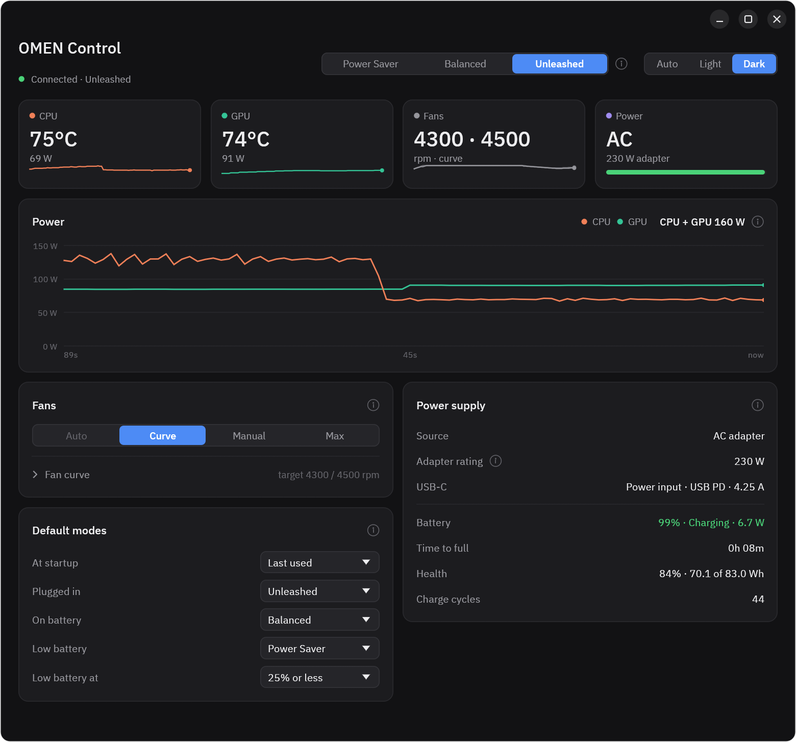

<p align="right"><strong>EN</strong> | <a href="./README.zh-CN.md">简</a></p>

<div align="center">
    
    <h1>omenctl</h1>
</div>

<p align="center">
    <em>Performance modes and fan control for the HP OMEN 16 (board 8D3F) on Linux.</em>
</p>

<p align="center">
    <a href="https://github.com/ZerunW/omen-ctl/actions/workflows/ci.yml"></a>
    <a href="https://github.com/ZerunW/omen-ctl/releases/latest"></a>
    
    
    
    
    <a href="LICENSE"></a>
</p>

<div align="center">
    
</div>

## What is omenctl?

omenctl is a patched `hp-wmi` kernel driver, a root service (`omenctld`), a command line
tool (`omenctl`) and a desktop app (OMEN Control) for the HP OMEN 16-am0xxx. It sends the
same firmware commands that OMEN Gaming Hub sends on Windows, which unlocks the CPU and GPU
power limits, and it drives the fans in software, because the firmware stops managing them
in that state. Everything ships as one `.deb` that `apt remove` takes out again.

> [!WARNING]
> omenctl runs as root, loads a modified kernel driver and changes how the embedded
> controller (EC) runs the fans and power limits. It is tested on one machine (board
> `8D3F`, BIOS F.14) and refuses to run on any other board. Read [Safety](#safety) before
> installing. There is no warranty; use it at your own risk.

## Why omenctl?

On Linux nothing sends the "performance" commands to this laptop's EC, so the CPU stays at
PL1 45 W / PL2 56 W (35/45 W in balanced) and the RTX 5060 at about 80 W. Switching the
EC into its performance state is easy; keeping it there is not: the limits only hold
while software keeps the fans under manual control, and the EC's own fan behaviour around
that state has sharp edges (a fan target of 0 means *stop*, and handing the fans back
can pause them for two minutes). omenctl handles those details and adds the safety
layers needed to run it unattended.

**Status: beta.** In daily use on the author's machine. The driver, service, command line
tool and desktop app are tested on hardware; parts of the
[hardware test checklist](docs/HARDWARE_TEST.md) are still open.

## Quick start

On an HP OMEN 16-am0xxx (`cat /sys/class/dmi/id/board_name` prints `8D3F`) with Ubuntu
24.04 and the HWE 7.0 kernel, download `omenctl_<version>_amd64.deb` from the
[latest release](https://github.com/ZerunW/omen-ctl/releases/latest), then:

```bash
sudo apt install ./omenctl_*_amd64.deb
sudo usermod -aG omenctl $USER               # log out and in
sudo reboot                                  # loads the patched driver
omenctl status
omenctl mode unleashed
omenctl-gui                                  # or "OMEN Control" in the app menu
```

## Features

### Modes

- **Power Saver, Balanced, Unleashed** — Unleashed raises the EC limits to CPU
  PL1 90 W / PL2 130 W / PL4 200 W and the GPU limit to 115 W.
- **Load-dependent EPP** — in Unleashed the CPU energy preference is `performance` while
  the CPU is busy (4.85 GHz single core) and `balance_performance` when idle (about 16 W
  instead of 31 W).
- **GPU priority** — while the GPU is busy in Unleashed the CPU sustained limit drops to
  70 W, so under combined load the GPU gets a 105 W limit instead of 85 W.
- **Default modes** — rules for startup, adapter plugged in, on battery and low battery.

### Fans

- **Four fan modes** — BIOS auto, per-fan curves (default: the BIOS fan table), a fixed
  speed, maximum.
- **Steady curves** — 5 s temperature average and a 15 s hold before slowing down, so short
  load spikes don't make the fans pump.
- **Recommended speed** — a manual speed below what the curve wants is allowed and flagged.

### Monitoring and apps

- **Power readout** — CPU and GPU power with a 90 s chart, adapter rating (from the BIOS),
  battery charge, draw, time left, health and cycles, USB-C power input.
- **Desktop app** — Auto / Light / Dark themes, its own window frame with GNOME-style
  buttons, text that follows the desktop text scaling, a drag-to-edit fan curve.
- **Command line** — `omenctl status | mode | fan | defaults`, with `status --json`.

### Packaging and safety

- **Four safety layers** — kernel watchdog, systemd watchdog with a safety script, fan
  speed check, thermal protection. Every failure ends with more cooling and less power.
- **One `.deb`** — DKMS driver (rebuilt and MOK-signed for new kernels), service, tools,
  `nvidia-powerd` setup, and a full rollback on removal.

| Light theme, on USB-C power (90 W) | Default modes |
|---|---|
|  |  |

## Measured results

HP OMEN 16-am0xxx, Ubuntu 24.04, HWE kernel 7.0, BIOS F.14.

| | stock Linux | omenctl Unleashed |
|---|---|---|
| EC CPU limits PL1 / PL2 / PL4 | 45 / 56 / 90 W | 90 / 130 / 200 W |
| CPU, 1 thread | – | 4.94 GHz |
| CPU, 8 threads (one per P-core) | – | 4.41 GHz @ 130 W |
| CPU, all 24 threads, first ~50 s | – | P 4.0–4.6 / E 3.3–3.7 GHz, 130 W |
| CPU, all 24 threads sustained | ~2.45 GHz @ ~45–56 W | P 3.5–3.78 / E 2.8–3.03 GHz, 90 W |
| GPU power limit | 80–83 W | 115 W |
| CPU + GPU at full load, sustained | – | CPU 70 W + GPU limit 105 W (GPU priority) |

Clock ranges depend on the load. `tools/stress-test.sh` reproduces the CPU, GPU and
combined tests as a normal user with omenctld in charge; how each EC fact was verified is
in [docs/internals.md](docs/internals.md#4-verified-behaviour).

## Compatibility

| | Supported |
|---|---|
| Laptop | HP OMEN 16-am0xxx, board `8D3F` (Intel Core, RTX 5060). The service and safety script do nothing on other boards. |
| BIOS | F.14 (tested) |
| Distribution | Ubuntu 24.04 |
| Kernel | 7.x (tested: HWE 7.0). DKMS skips other kernels, which keep the stock driver. |
| Secure Boot | Off, or on with Ubuntu's DKMS MOK key enrolled |
| GPU | NVIDIA driver with `nvidia-powerd` for the GPU power boost |

Other OMEN and Victus boards use different EC layouts and are not supported. Reports from
the same board on other BIOS versions are welcome.

## Installation

Requirements: kernel headers for the running kernel (`linux-headers-generic-hwe-24.04`),
Secure Boot either off or with a MOK key enrolled for DKMS (Ubuntu sets this up when you
install third-party drivers; check with `mokutil --list-enrolled`).

```bash
sudo apt install ./omenctl_<version>_amd64.deb
sudo usermod -aG omenctl $USER
sudo reboot
```

The install creates the `omenctl` group, builds the driver with DKMS, enables
`omenctld.service` for the next boot, enables `nvidia-powerd` and copies the example config
to `/etc/omenctl/config.toml`. After the reboot:

```bash
modinfo -n hp_wmi                            # .../updates/dkms/hp-wmi.ko*
systemctl status omenctld
omenctl status
```

**Uninstall.** `sudo apt remove omenctl` removes the programs and the DKMS driver, gives the
fans back to the BIOS and restores the NVIDIA service settings; reboot to load the stock
driver. `sudo apt purge omenctl` also deletes `/etc/omenctl`, `/var/lib/omenctl` and the
`omenctl` group (if the package created it).

## Usage

```bash
omenctl status                    # or: omenctl status --json
omenctl mode unleashed            # saver | balanced | unleashed
omenctl fan curve                 # auto | curve | max | 18..52 (units of 100 rpm)
omenctl fan 30                    # fixed 3000 rpm
omenctl defaults ac unleashed     # startup | ac | battery | low, then keep | saver | balanced | unleashed
omenctl defaults low-at 15        # low battery threshold, 5-50 %
omenctl-gui --theme dark          # system | light | dark, for this run only
```

`fan auto` is refused in Unleashed (the EC would drop the raised limits). Errors exit
with code 1. The desktop app and every command are described in the
[user guide](docs/USER_GUIDE.md).

## Configuration

`/etc/omenctl/config.toml` holds the default mode, mode rules, fan curve smoothing, the
EPP and GPU priority options, optional RAPL limits per mode and the protection thresholds.
Every key has a safe default, unknown keys are logged, and an invalid file makes the service
refuse to start. Apply changes with `sudo systemctl restart omenctld`. The full table is in
the [user guide](docs/USER_GUIDE.md#8-configuration); the annotated example is
[`packaging/config.toml`](packaging/config.toml).

## Build from source

Needs Rust 1.97 or newer (or Ubuntu's `cargo-1.97`), `dpkg-dev`, `pkg-config`,
`libwayland-dev`, `libxkbcommon-dev` and network access for the crates.

```bash
git clone https://github.com/ZerunW/omen-ctl
cd omen-ctl
(cd app && cargo test)            # unit tests + an end-to-end test of the service on a fake sysfs tree
packaging/build-deb.sh            # -> packaging/out/omenctl_<version>_amd64.deb
```

`CARGO=cargo-1.97 packaging/build-deb.sh` uses Ubuntu's versioned cargo. Building changes
nothing on the system. CI runs the tests and builds the `.deb` on every push; a `v*` tag
publishes a release with the package attached.

## How it works

```text
omenctl-gui (user)      omenctl (user)
          \                 /
      /run/omenctl.sock   (group omenctl, line-delimited JSON)
                   |
     omenctld (root, systemd Type=notify, watchdog)
                   |   standard sysfs files only
   platform_profile · hwmon pwm · omenctl_kick · omenctl_concurrent_tdp · omenctl_adapter_w
                   |
     hp-wmi (patched, DKMS)  ->  BIOS WMI  ->  EC
```

Findings from the decompiled BIOS and EC readings on 8D3F:

- WMI query `0x1A` writes the mode byte into EC `0x95`; in `0x31` the EC raises
  PL1/PL2/PL4 to 90/130/200 W.
- Query `0x10` opens a ~120 s window in which the EC runs the fans at the software targets
  (`0x2E`). The performance limits only hold while that window is kept alive, so the fans
  must be driven by software. The driver refreshes it every 90 s in manual fan mode.
- A `0x2E` fan target of 0 means **stop**, not automatic.
- Query `0x29` byte 3 sets the CPU+GPU target used by NVIDIA Dynamic Boost; 75 W (the value
  OMEN Gaming Hub uses) lifts the GPU limit to 115 W.

The patch on top of mainline `hp-wmi` adds, on 8D3F only: the 75 W concurrent target, a
kernel fan watchdog (`omenctl_kick`), a fan handover to the BIOS that holds the current speed
instead of stopping the fans, and a read-only adapter rating. Userspace never writes the EC
directly. Details, the EC field map and the verified behaviour are in
[docs/internals.md](docs/internals.md).

### Repository layout

| Path | Content |
|---|---|
| `app/omenctl-core` | Fan curve, configuration, sysfs access, control loop, protocol |
| `app/omenctld` | Service |
| `app/omenctl-cli` | Command line tool `omenctl` |
| `app/omenctl-gui` | Desktop app (egui) |
| `hpwmi-upstream/` | Upstream `hp-wmi.c`, the omenctl patch and the patched source built by DKMS ([provenance](hpwmi-upstream/README.md)) |
| `packaging/` | `.deb` build script, systemd units, DKMS config, maintainer and safety scripts, icon |
| `tools/` | Read-only EC snapshot, ACPI extraction (`dump-acpi.sh`), hardware test scripts |
| `docs/` | User guide, internals, hardware test checklist, screenshots |

## Safety

omenctl writes firmware settings that affect cooling. The design assumes something will
eventually go wrong and makes every failure end with faster fans and lower power:

- **Kernel watchdog** — while the fans are manual the service kicks the driver every
  second; after 15 s without a kick the driver sets both fans to maximum on its own.
- **systemd watchdog** — a hung service is killed and restarted; after any abnormal stop a
  safety script sets the fans to maximum and the profile to balanced, and hands the fans
  back to the BIOS only once the CPU is below 60 °C.
- **Fan check** — measured speed below 70 % of the target for 10 s: fans to maximum,
  Unleashed is left.
- **Thermal protection** — 92 °C sends both fans to maximum in every fan mode; 10 s at 95 °C
  leaves Unleashed until the machine has cooled. A missing CPU temperature counts as hot.
- **Narrow command set** — only values observed from OMEN Gaming Hub are sent; the
  firmware "max fan" switch, which can freeze the fans on this model, is never used.

What it cannot protect against: firmware or EC behaviour that differs from BIOS F.14, a
board other than 8D3F forced past the checks, or physical cooling problems (blocked vents,
a failing fan). The CPU's and GPU's own thermal throttling stays active underneath.
To report a security issue, see [SECURITY.md](SECURITY.md).

## Troubleshooting

<details>
<summary><strong><code>omenctl: cannot reach the omenctl service</code></strong></summary>

Check `systemctl status omenctld` and `journalctl -u omenctld -b`. If the service was
"skipped", the patched driver is not loaded: `modinfo -n hp_wmi` must point to
`updates/dkms`; see `dkms status` and `journalctl -k -b | grep -i hp_wmi`.

</details>

<details>
<summary><strong>No permission to use <code>/run/omenctl.sock</code></strong></summary>

`id` must list `omenctl`. Log out and in again after `usermod -aG omenctl $USER`.

</details>

<details>
<summary><strong>The driver does not load with Secure Boot</strong></summary>

Check `mokutil --sb-state` and that the DKMS key is enrolled; `modinfo hp_wmi | grep signer`
shows which key signed the module.

</details>

<details>
<summary><strong>The GPU stays at the old power limit</strong></summary>

`systemctl status nvidia-powerd` (or `omenctl-nvidia-powerd`), then
`nvidia-smi -q -d POWER` while the GPU is under load.

</details>

<details>
<summary><strong>Fans stuck at full speed</strong></summary>

`cat /sys/devices/platform/hp-wmi/omenctl_kick`: `tripped=1` means the kernel watchdog fired.
Check that the service is running.

</details>

<details>
<summary><strong>Bluetooth keyboard can't wake the laptop from suspend</strong></summary>

That is a BlueZ problem, not an OMEN one; see the companion project
[ubuntu-ble-wake-fix](https://github.com/ZerunW/ubuntu-ble-wake-fix).

</details>

More cases and an emergency rollback without the package tools are in the
[user guide](docs/USER_GUIDE.md#11-troubleshooting).

## Documentation

- [User guide](docs/USER_GUIDE.md) — install, modes, fans, desktop app, command line,
  configuration, troubleshooting, rollback
- [Internals](docs/internals.md) — WMI commands, EC fields, verified behaviour, driver patch
- [Hardware test checklist](docs/HARDWARE_TEST.md) — step-by-step tests with rollback
- [Changelog](CHANGELOG.md)

## Contributing

Bug reports, test results from other BIOS versions and pull requests are welcome. See
[CONTRIBUTING.md](CONTRIBUTING.md) for how to build, test and what changes need hardware
evidence.

## Acknowledgments

- The Linux [`hp-wmi`](https://git.kernel.org/pub/scm/linux/kernel/git/torvalds/linux.git/tree/drivers/platform/x86/hp/hp-wmi.c)
  driver and its authors. omenctl's driver is mainline commit `e931e54edb0f` plus a small
  patch (GPL-2.0-or-later); see [hpwmi-upstream/README.md](hpwmi-upstream/README.md).
- [ohman](https://github.com/P4R1H/ohman) for OMEN firmware research.
- [OmenMon-Reborn](https://github.com/metamountain/OmenMon-Reborn-8BCA) for the 8D3F
  max-fan freeze report (#137).
- [hp-omen-8603-linux](https://github.com/PickleHik3/hp-omen-8603-linux) for notes on a
  related OMEN board.
- [omen_max_gpu_unlock](https://github.com/WangSteve123/omen_max_gpu_unlock), on which the
  `nvidia-powerd` D-Bus policy is based.
- [egui / eframe](https://github.com/emilk/egui) for the desktop app,
  [nvml-wrapper](https://github.com/rust-nvml/nvml-wrapper) for GPU readings, and
  [IBM Plex Sans](https://github.com/IBM/plex) (SIL OFL 1.1) as the UI font.

## License

[GPL-2.0-or-later](LICENSE) © [Zerun Wang](https://github.com/ZerunW)

The driver is derived from the Linux kernel's `hp-wmi.c`. The desktop app links
Apache-2.0 libraries (winit, glutin), so the `omenctl-gui` binary as a whole is distributed
under GPL-3.0-or-later. The bundled IBM Plex Sans font is under the SIL Open Font License
1.1 ([`app/omenctl-gui/assets/IBMPlexSans-LICENSE.txt`](app/omenctl-gui/assets/IBMPlexSans-LICENSE.txt)).
The notices of all Rust libraries are installed as
`/usr/share/doc/omenctl/THIRD-PARTY-LICENSES.txt.gz`. HP's ACPI tables are not part of this
repository (see `tools/dump-acpi.sh`).
