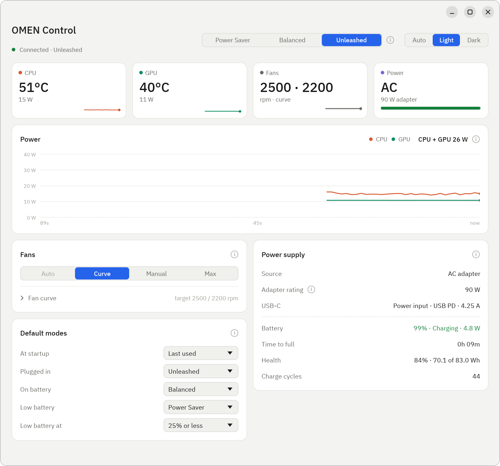
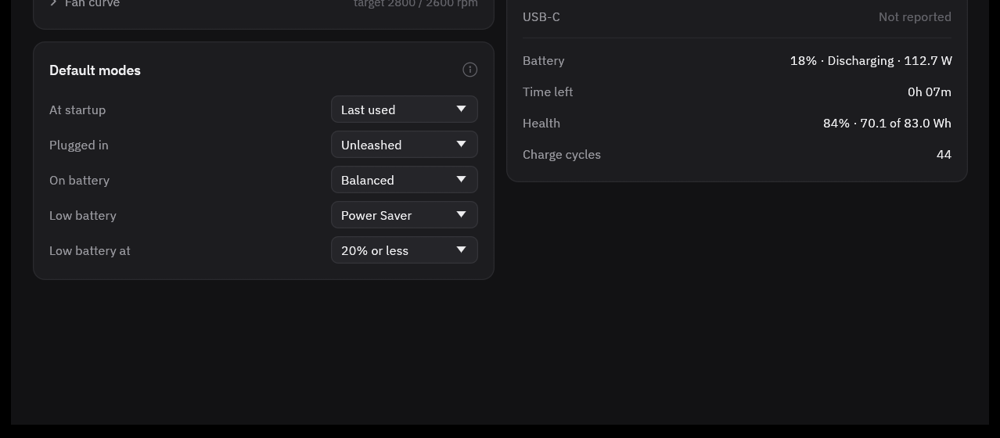

English | [简体中文](README.zh-CN.md)

<div align="center">
    
    <h1>omenctl</h1>
</div>

<p align="center">
    <em>Full performance mode and fan control for the HP OMEN 16 on Linux, like OMEN Gaming Hub on Windows.</em>
</p>

<p align="center">
    <a href="https://github.com/ZerunW/omen-ctl/actions/workflows/ci.yml"></a>
    <a href="https://github.com/ZerunW/omen-ctl/releases/latest"></a>
    
    
    
    <a href="LICENSE"></a>
</p>

<div align="center">
    
</div>

## What is omenctl?

On Linux, an OMEN 16 runs with the handbrake on: the CPU and the graphics card stay
well below their power limits, because nothing tells the laptop to switch to its
performance mode. omenctl does what OMEN Gaming Hub does on Windows. It gives you an app called **OMEN Control** with three power
modes and your choice of fan behaviour, plus a live view of temperatures, fan speeds and
power draw. Everything comes as a single `.deb` that you can remove again with one
command.

## What you get

- **Unleashed mode** — the full CPU and GPU power the hardware is built for: roughly twice
  the sustained CPU power of stock Linux and up to 115 W for the RTX 5060 (stock: about
  80 W).
- **Power Saver and Balanced** — quieter, cooler and longer battery life when you don't
  need the speed.
- **Fan control** — let the BIOS decide, follow a fan curve that you can edit by dragging
  points, pick a fixed speed, or run both fans at full speed.
- **Automatic switching** — for example Unleashed when plugged in, Balanced on battery,
  Power Saver when the battery runs low.
- **Live readouts** — CPU and GPU temperature and power, fan speeds, adapter rating,
  battery charge, health and time left.
- **Charge limit**: for a laptop that stays plugged in, stop charging at e.g. 60 % and
  charge again at 55 %, with a one-time full charge before a trip.
- **Lid close**: keep running with the lid closed (while plugged in, or always), to use
  the laptop as a small server.
- **Remote monitor** (optional, off by default): a read-only web dashboard with every CPU
  core, memory, both GPUs and their processes, all processes, fans, power, network and VPN
  state, for viewing from another device through a tunnel such as Cloudflare Tunnel.
- **Safety built in** — if anything goes wrong the fans speed up and the power limits
  drop. See [Safety](#safety).

## Will it work on my laptop?

| | Supported |
|---|---|
| Laptop | HP OMEN 16-am0xxx, board `8D3F` (Intel Core, RTX 5060) |
| BIOS | F.14 (tested) |
| System | Ubuntu 24.04 with the HWE kernel 7.x (tested: 7.0) |
| Secure Boot | Off, or on with the Ubuntu key enrolled (the install steps cover it) |
| Graphics | NVIDIA driver installed from Ubuntu's packages |

To check your laptop, open a terminal and run:

```bash
cat /sys/class/dmi/id/board_name
```

If it prints `8D3F`, you are good. Any other answer means the laptop is not supported:
other OMEN and Victus models use a different controller, and omenctl refuses to run on
them. To check the kernel, run `uname -r`; it should start with `7.`

## Install

1. Download `omenctl_<version>_amd64.deb` from the
   [latest release](https://github.com/ZerunW/omen-ctl/releases/latest).
2. Open a terminal in the folder where the file was saved (usually `Downloads`) and run:
   ```bash
   sudo apt install ./omenctl_*_amd64.deb
   ```
   The installer builds the driver for your kernel, which takes a minute or two.
3. Add yourself to the `omenctl` group so the app may change settings without a password:
   ```bash
   sudo usermod -aG omenctl $USER
   ```
4. Restart the laptop. This loads the new driver. The background service starts by itself
   from now on.
5. Open **OMEN Control** from the application menu (or run `omenctl-gui`). The top left
   should say "Connected".

**Secure Boot.** If Secure Boot is on, the driver has to be signed with a key your
computer trusts. Ubuntu normally sets this up for you the first time a driver is built:
it asks you to choose a one-time password during step 2, and the next restart shows a blue
"MOK management" screen where you choose *Enroll MOK* and type that password. If the
install ends with "THE DRIVER COULD NOT BE BUILT", see the FAQ below. Turning Secure Boot
off in the BIOS setup also works.

## Using OMEN Control

Start **OMEN Control** from the application menu. The mode and fan buttons take effect
immediately, and the app can be closed at any time, because a background service does
the actual work and keeps the chosen mode after a restart. There is no tray icon.

### Modes

Pick one with the buttons at the top right.

| Mode | What it means in practice |
|---|---|
| **Power Saver** | Lowest power and heat. Use it on battery or for light work. |
| **Balanced** | The system's standard power limits. Fine for everyday use. |
| **Unleashed** | Full CPU and GPU power for games, rendering and compiling. The fans are always controlled by omenctl in this mode, so the fan setting "Auto" is not available. |

If the CPU or GPU stays at 95 °C, Unleashed pauses by itself and comes back once the
machine has cooled down.

### Fans

| Fan setting | What the fans do |
|---|---|
| **Auto** | The BIOS decides (not available in Unleashed). |
| **Curve** | Each fan follows its own temperature curve. This is the default. Open **Fan curve**, drag the points and press **Apply**. **Reset to BIOS table** goes back to HP's curve. |
| **Manual** | Both fans at one fixed speed (1800 to 5200 rpm) set with a slider. If you choose less than the curve would, the app tells you. |
| **Max** | Both fans at full speed. |

### Default modes

The **Default modes** card lets the laptop pick a mode by itself: at startup, when you
plug in, when you unplug, and when the battery drops below a level you choose.

| Light theme, on USB-C power | Default modes card |
|---|---|
|  |  |

The **Auto / Light / Dark** buttons switch the theme, and the (i) icons explain each
part of the window. The same things are available from a terminal:

```bash
omenctl status                 # current mode, temperatures, fans
omenctl mode unleashed         # saver | balanced | unleashed
omenctl fan curve              # auto | curve | max | a speed such as 30 (3000 rpm)
```

The full list of settings, the config file and the command line are in the
[user guide](docs/USER_GUIDE.md).

## Safety

omenctl controls the fans and the power limits, so it is built to fail towards cooling:
if the service hangs or stops unexpectedly, the fans go to full speed and the laptop drops
back to Balanced, and Unleashed pauses by itself at high temperatures. It has been tested
on one machine only (board `8D3F`, BIOS F.14) and comes with no warranty. If the fans ever
misbehave, choose **Max** in the app, or run `sudo systemctl stop omenctld` (the fans go to full
speed, then back to the BIOS once the CPU has cooled), or restart the laptop, and see the
[safety details](docs/USER_GUIDE.md#12-safety) and [SECURITY.md](SECURITY.md).

## Uninstall

```bash
sudo apt remove omenctl
sudo reboot
```

This gives the fans back to the BIOS and restores the original driver after the restart.
`sudo apt purge omenctl` also deletes the settings. A rollback that works without the
package tools is in the [user guide](docs/USER_GUIDE.md#15-uninstall-and-rollback).

## FAQ and troubleshooting

<details>
<summary><strong>The app says it cannot reach the service</strong></summary>

You probably have not restarted since installing. Restart the laptop, then check
`systemctl status omenctld`. If it says "skipped", the patched driver is not loaded; see
the next entries.

</details>

<details>
<summary><strong>"No permission to use /run/omenctl.sock"</strong></summary>

Your user is not in the `omenctl` group yet. Run `sudo usermod -aG omenctl $USER`, then
log out and in again (or restart). `id` should list `omenctl`.

</details>

<details>
<summary><strong>The install says the driver could not be built</strong></summary>

Usually the kernel headers are missing or Secure Boot has no enrolled key. Install the
headers with `sudo apt install linux-headers-generic-hwe-24.04`, then run
`sudo dkms install omenctl-hp-wmi/<version>` and restart. With Secure Boot on, check that
the key was enrolled (`mokutil --list-enrolled`) or turn Secure Boot off. The build log is
in `/var/lib/dkms/omenctl-hp-wmi/<version>/build/make.log`.

</details>

<details>
<summary><strong>The GPU still seems limited to about 80 W</strong></summary>

Switch to Unleashed and put the GPU under load, then run `nvidia-smi -q -d POWER`. The
boost needs NVIDIA's `nvidia-powerd` service, which the installer enables; check it with
`systemctl status nvidia-powerd`.

</details>

<details>
<summary><strong>The fans are stuck at full speed</strong></summary>

That is the safety fallback. Check that the service is running with
`systemctl status omenctld`, then pick a mode again in the app.

</details>

<details>
<summary><strong>Can I use it on another OMEN or Victus model?</strong></summary>

No. Other models use a different embedded controller, and omenctl only runs on board
`8D3F`. Reports from the same board with other BIOS versions are welcome.

</details>

<details>
<summary><strong>My Bluetooth keyboard cannot wake the laptop</strong></summary>

That is a Linux Bluetooth problem rather than an OMEN one; see
[ubuntu-ble-wake-fix](https://github.com/ZerunW/ubuntu-ble-wake-fix).

</details>

More cases are in the [user guide](docs/USER_GUIDE.md#14-troubleshooting).

## Build from source

You need Rust 1.97 or newer and a few system libraries. In short:

```bash
git clone https://github.com/ZerunW/omen-ctl
cd omen-ctl
packaging/build-deb.sh            # -> packaging/out/omenctl_<version>_amd64.deb
```

Requirements, tests and the repository layout are in [CONTRIBUTING.md](CONTRIBUTING.md)
and the [user guide](docs/USER_GUIDE.md#2-get-the-package). Pushing a `v*` tag publishes a
release with the package attached.

## Documentation

| Document | What is in it |
|---|---|
| [User guide](docs/USER_GUIDE.md) | Every mode, fan setting and option, configuration file, command line, safety rules, troubleshooting, rollback |
| [Internals](docs/internals.md) | How it works: firmware (WMI) commands, controller fields, measured results, the driver patch, control rules, safety layers |
| [Hardware test checklist](docs/HARDWARE_TEST.md) | Step-by-step tests with rollback, for testers |
| [Changelog](CHANGELOG.md) | What changed in each version |

## Contributing

Bug reports, test results from other BIOS versions and pull requests are welcome. See
[CONTRIBUTING.md](CONTRIBUTING.md).

## Acknowledgments

- The Linux [`hp-wmi`](https://git.kernel.org/pub/scm/linux/kernel/git/torvalds/linux.git/tree/drivers/platform/x86/hp/hp-wmi.c)
  driver and its authors. omenctl's driver is mainline commit `e931e54edb0f` plus a small
  patch (GPL-2.0-or-later); see [hpwmi-upstream/README.md](hpwmi-upstream/README.md).
- [ohman](https://github.com/P4R1H/ohman) for OMEN firmware research.
- [OmenMon-Reborn](https://github.com/metamountain/OmenMon-Reborn-8BCA) for the 8D3F
  max-fan freeze report (#137).
- [hp-omen-8603-linux](https://github.com/PickleHik3/hp-omen-8603-linux) for notes on a
  related OMEN board.
- [omen_max_gpu_unlock](https://github.com/WangSteve123/omen_max_gpu_unlock), on which the
  `nvidia-powerd` D-Bus policy is based.
- [egui / eframe](https://github.com/emilk/egui) for the desktop app,
  [nvml-wrapper](https://github.com/rust-nvml/nvml-wrapper) for GPU readings, and
  [IBM Plex Sans](https://github.com/IBM/plex) (SIL OFL 1.1) as the UI font.

## License

[GPL-2.0-or-later](LICENSE) © [Zerun Wang](https://github.com/ZerunW)

The driver is derived from the Linux kernel's `hp-wmi.c`. The desktop app links
Apache-2.0 libraries (winit, glutin), so the `omenctl-gui` binary as a whole is distributed
under GPL-3.0-or-later. The bundled IBM Plex Sans font is under the SIL Open Font License
1.1 ([`app/omenctl-gui/assets/IBMPlexSans-LICENSE.txt`](app/omenctl-gui/assets/IBMPlexSans-LICENSE.txt)).
The notices of all Rust libraries are installed as
`/usr/share/doc/omenctl/THIRD-PARTY-LICENSES.txt.gz`. HP's ACPI tables are not part of this
repository (see `tools/dump-acpi.sh`).
