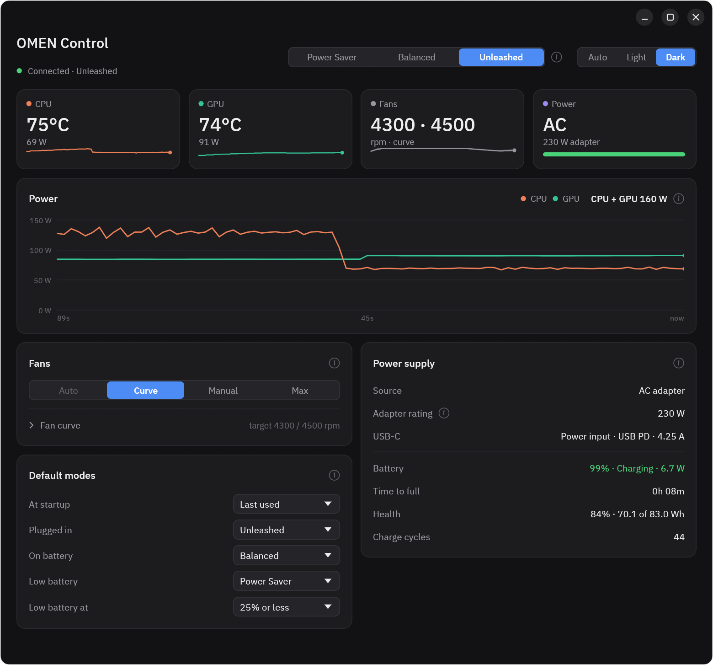
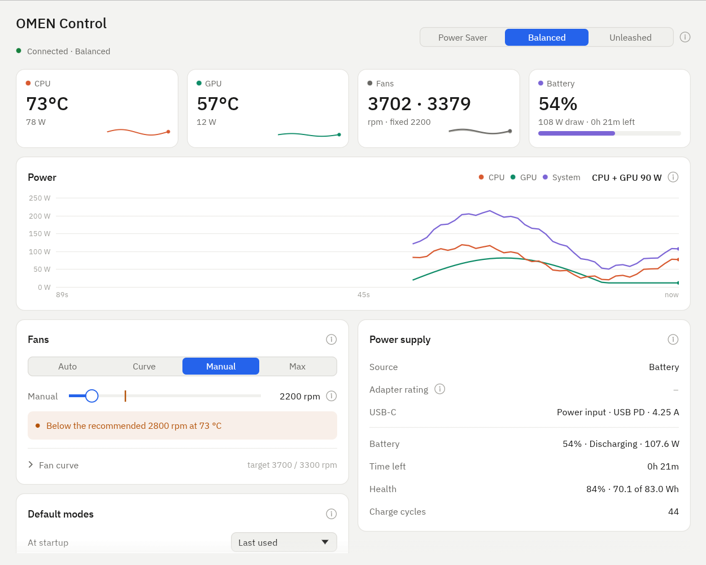
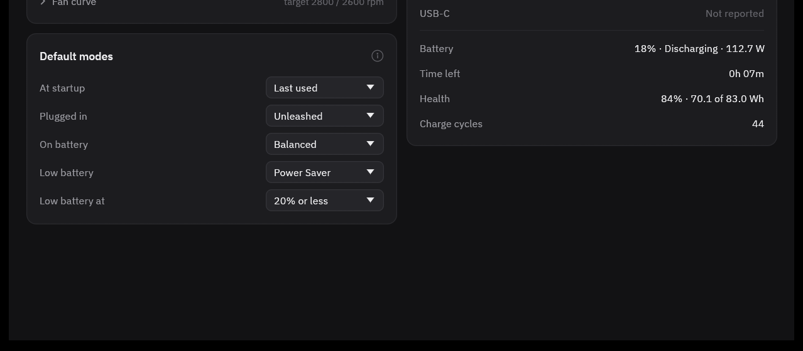

# omenctl

English | [简体中文](README.zh-CN.md)

Performance and fan control for the **HP OMEN 16-am0xxx (board 8D3F)** on Linux.

On Linux this laptop's embedded controller (EC) keeps the CPU at PL1 45 W / PL2 56 W
(35/45 W in balanced) and the RTX 5060 at ~80 W, because nothing sends the firmware
commands that OMEN Gaming Hub sends on Windows. omenctl reproduces those commands through
the kernel's `hp-wmi` driver and adds the fan control the firmware expects in that state.

**Status: beta.** Runs daily on the author's machine (driver, service, command line tool
and desktop app tested on hardware); parts of the hardware test checklist
([docs/HARDWARE_TEST.md](docs/HARDWARE_TEST.md)) are still open. Use at your own risk.



## Measured results (Ubuntu 24.04, HWE kernel 7.0, BIOS F.14)

| | stock Linux | omenctl "Unleashed" |
|---|---|---|
| EC CPU limits PL1 / PL2 / PL4 | 45 / 56 / 90 W | 90 / 130 / 200 W |
| CPU, 1 thread | – | 4.94 GHz |
| CPU, 8 threads (one per P-core) | – | 4.41 GHz @ 130 W |
| CPU, all 24 threads sustained | ~2.45 GHz @ ~45–56 W | P 3.78 / E 3.03 GHz, 90 W |
| GPU power limit | 80–83 W | 115 W |

Raw logs are in [`logs/`](logs/).

## Features

- Three modes: **Power Saver**, **Balanced**, **Unleashed** (CPU 90/130 W, GPU 115 W).
  Unleashed keeps the CPU energy preference at `balance_performance`, so an idle desktop
  stays at ~25 W instead of ~45 W while full load runs at the same limits.
- Default modes: at startup, when the adapter is plugged in, on battery, and when the
  battery runs low.
- Fans: BIOS auto, per-fan curves (default: the BIOS fan table), manual speed, maximum.
  Curves use a 5 s temperature average and hold the speed 15 s before slowing down, so
  short load spikes don't make the fans pump. A manual speed below what the curve
  recommends is allowed and flagged.
- Power readout: CPU and GPU power with a 90 s chart, adapter rating (from the BIOS),
  battery charge, draw, time left, health and cycles, USB-C power input.
- Desktop app (OMEN Control) with Auto / Light / Dark themes; command line tool
  `omenctl status | mode ... | fan ... | defaults ...`.
- Four safety layers; every failure ends with more cooling and less power.
- One `.deb`: DKMS driver (rebuilt and MOK-signed for new kernels), service, tools,
  `nvidia-powerd`. `apt remove` takes it all out again (see below).

## Install

Requirements: HP OMEN 16-am0xxx (board `8D3F`, check `cat /sys/class/dmi/id/board_name`),
Ubuntu 24.04 with the HWE 7.0 kernel, Secure Boot either off or with a MOK key enrolled
for DKMS (Ubuntu sets this up when you install third-party drivers).

Download `omenctl_<version>_amd64.deb` from the
[latest release](https://github.com/ZerunW/omen-ctl/releases/latest), then

```bash
sudo apt install ./omenctl_*_amd64.deb
sudo usermod -aG omenctl $USER               # log out and in
sudo reboot
omenctl status
omenctl mode unleashed
omenctl-gui                                  # or "OMEN Control" in the app menu
```

Uninstall: `sudo apt remove omenctl` removes the programs and the DKMS driver, gives the
fans back to the BIOS and restores the NVIDIA service settings; reboot to load the stock
driver again. `sudo apt purge omenctl` also deletes `/etc/omenctl`, `/var/lib/omenctl` and
the `omenctl` group (if the package created it). Full instructions, configuration and
troubleshooting: [docs/USER_GUIDE.md](docs/USER_GUIDE.md). Changes per version:
[CHANGELOG.md](CHANGELOG.md).

Bluetooth keyboard can't wake the laptop from suspend? That is a BlueZ problem, not an
OMEN one; see the companion project [ubuntu-ble-wake-fix](https://github.com/ZerunW/ubuntu-ble-wake-fix).

| Light theme, on battery | Default modes |
|---|---|
|  |  |

## How it works (8D3F specifics)

Findings from the decompiled BIOS (DSDT and SSDT17 of BIOS F.14) and EC readings. The
firmware tables are HP's code and are not included; `tools/dump-acpi.sh` extracts and
decompiles them from your own machine so you can follow the method names below:

- WMI `0x20008`/`0x1A` writes the mode byte straight into EC `0x95` (0x30 balanced,
  0x31 performance, 0x04 is also recognised). In 0x31 the EC raises PL1/PL2/PL4 to 90/130/200 W.
- `0x10` opens a ~120 s window in which the EC runs the fans at the software targets
  (`0x2E`, EC `0x34/0x35`) instead of its own curve. The performance limits only hold while
  that window is kept alive, so the fans must be driven by software (this is what OMEN Gaming
  Hub does). The upstream driver refreshes the window every 90 s in manual fan mode.
- A `0x2E` target of 0 means **stop**, not automatic, on this EC.
- `0x29` byte 3 sets the CPU+GPU concurrent target used by NVIDIA Dynamic Boost
  (`NPCF.OPAT = W * 8`); 75 W (the value OMEN Gaming Hub uses) lifts the GPU limit to 115 W.
  Bytes 0/1 are PL2/PL1 (order is swapped versus the upstream struct).
- The BIOS does almost no parameter validation, so only values observed from
  OMEN Gaming Hub are ever sent.

## Architecture

```
omenctl-gui (user)     omenctl (user)
          \               /
     /run/omenctl.sock  (group omenctl, line-delimited JSON)
                 |
        omenctld (root, systemd Type=notify, watchdog)
                 |   standard sysfs only
   platform_profile · hp-wmi hwmon pwm · omenctl_kick · omenctl_concurrent_tdp · omenctl_adapter_w
                 |
        hp-wmi (patched, DKMS)  ->  BIOS WMI  ->  EC
```

## Repository layout

| Path | Content |
|---|---|
| `app/omenctl-core` | fan curve, configuration, sysfs access, control loop, protocol |
| `app/omenctld` | service |
| `app/omenctl-cli` | command line tool `omenctl` |
| `app/omenctl-gui` | desktop app (egui) |
| `packaging/` | `.deb` build script, systemd units, DKMS config, maintainer and safety scripts, app icon |
| `docs/` | user guide, hardware test checklist, screenshots |
| `hpwmi-upstream/` | upstream `hp-wmi.c` (commit `e931e54edb0f`) + `backport.patch` |
| `tools/` | read-only EC snapshot script, ACPI extraction script (`dump-acpi.sh`) and hardware test scripts |
| `logs/` | test logs |
| `PLAN.md` | design and implementation plan (Chinese) |

### Driver changes (`hpwmi-upstream/backport.patch`)

On top of mainline `hp-wmi` (which already supports 8D3F since v7.4-rc1):

1. builds on Ubuntu's 7.0 HWE kernel (`ACPI_AC_CLASS`);
2. `omenctl_concurrent_tdp` (write-only, accepts only `75`, 8D3F only);
3. kernel fan watchdog: `omenctl_kick`; if userspace stops kicking for 15 s while fans are
   manual, the driver forces both fans to the top table level;
4. smooth fan handover on 8D3F: returning fans to BIOS writes the current speed instead of 0;
5. `omenctl_adapter_w` (read-only, 8D3F only): rated adapter power from the read-only BIOS
   query 0x0F, which only reads EC fields (`WMID.GSAS` in the DSDT).

## Safety design

- No direct EC writes; userspace only touches standard sysfs files.
- Fans go manual before any profile switch; BIOS-auto fans are refused in Unleashed.
- Four layers: kernel watchdog, systemd watchdog with a safety script after abnormal
  exits, fan speed check, thermal protection that lowers power.

## Build and test

```bash
cd app && cargo test      # unit tests + an end-to-end test of the service on a fake sysfs tree
packaging/build-deb.sh    # -> packaging/out/omenctl_<version>_amd64.deb (needs Rust, dpkg-dev)
```

GitHub Actions runs the tests on every push and builds the `.deb`; pushing a `v*` tag
publishes a release with the package attached.

## License

GPL-2.0-or-later (the driver is derived from the Linux kernel's `hp-wmi.c`). See `LICENSE`.
The desktop app links Apache-2.0 libraries (winit, glutin), so the `omenctl-gui` binary as a
whole is distributed under GPL-3.0-or-later. The bundled IBM Plex Sans font is under the
SIL Open Font License 1.1 (`app/omenctl-gui/assets/IBMPlexSans-LICENSE.txt`). The notices of
all Rust libraries are installed as `/usr/share/doc/omenctl/THIRD-PARTY-LICENSES.txt.gz`.

The ACPI tables of the HP firmware are not part of this repository (see
`tools/dump-acpi.sh`).

## References

- Linux `drivers/platform/x86/hp/hp-wmi.c`
- [ohman](https://github.com/P4R1H/ohman) firmware research
- [OmenMon-Reborn](https://github.com/metamountain/OmenMon-Reborn-8BCA) (8D3F max-fan freeze report)
- [hp-omen-8603-linux](https://github.com/PickleHik3/hp-omen-8603-linux)
