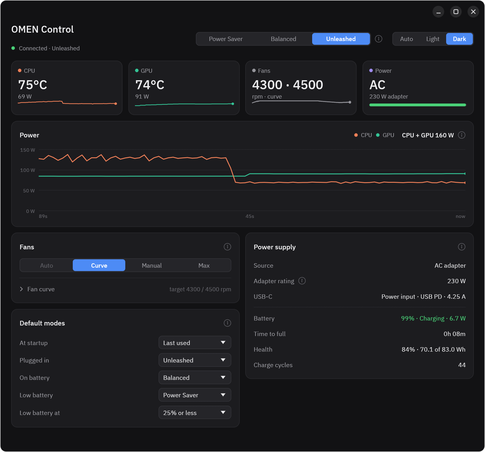
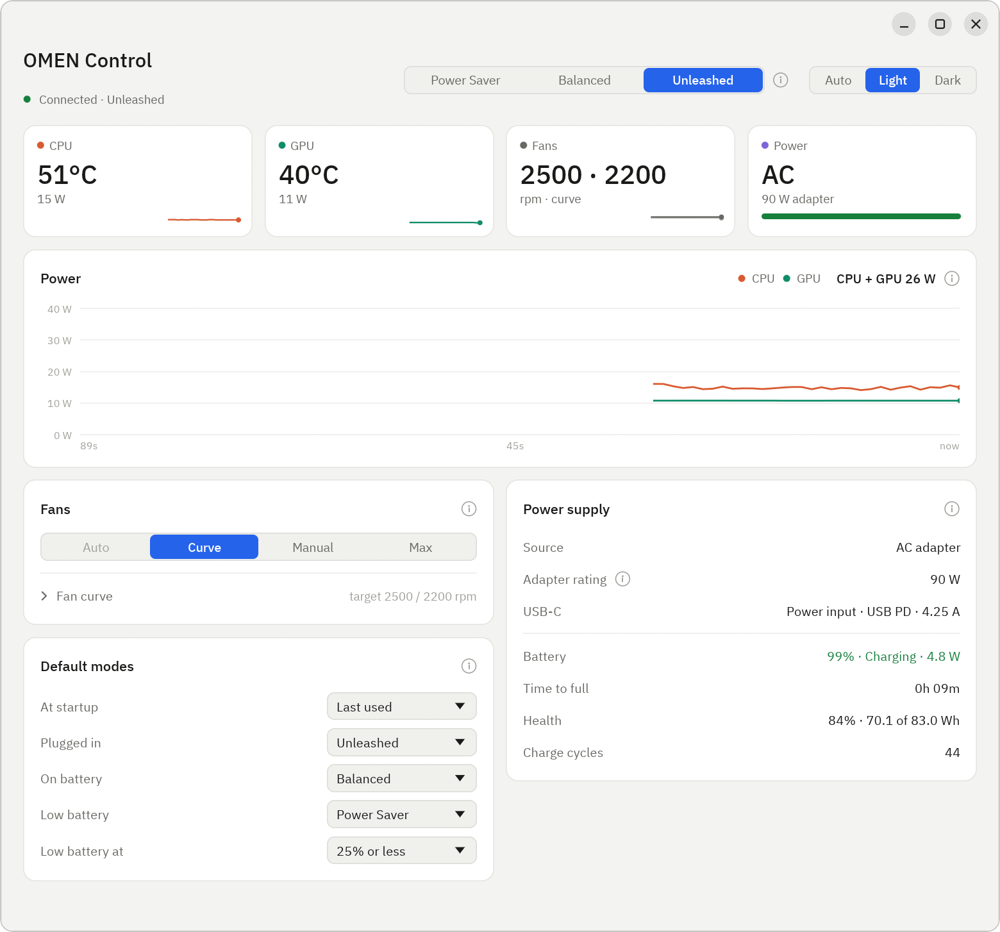
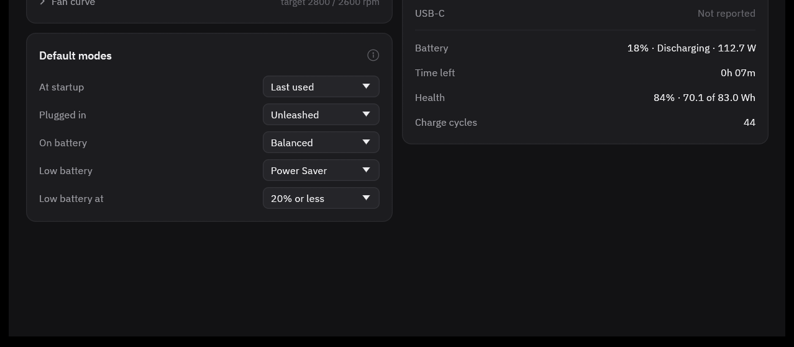

[English](README.md) | 简体中文

<div align="center">
    
    <h1>omenctl</h1>
</div>

<p align="center">
    <em>在 Linux 上给 HP OMEN 16 完整的性能模式和风扇控制，就像 Windows 上的 OMEN Gaming Hub。</em>
</p>

<p align="center">
    <a href="https://github.com/ZerunW/omen-ctl/actions/workflows/ci.yml"></a>
    <a href="https://github.com/ZerunW/omen-ctl/releases/latest"></a>
    
    
    
    <a href="LICENSE"></a>
</p>

<div align="center">
    
</div>

## omenctl 是什么？

在 Linux 下，OMEN 16 一直是“拉着手刹”在跑：没有程序告诉笔记本切换到性能模式，CPU 和显卡的功率都被压在
远低于上限的水平。omenctl 做的就是 Windows 上 OMEN Gaming Hub 做的事。它提供一个叫 **OMEN Control**
的应用，有三种功率模式，风扇行为可以自选，还能实时查看温度、风扇转速和功耗。所有东西打包成一个 `.deb`，
一条命令就能卸载干净。

## 你能得到什么

- **Unleashed（释放）模式** — 发挥硬件应有的 CPU 和显卡功率：CPU 持续功率约为原版 Linux 的两倍，
  RTX 5060 最高 115 W（原版约 80 W）。
- **Power Saver（省电）和 Balanced（平衡）** — 不需要性能时更安静、更凉，续航更长。
- **风扇控制** — 交给 BIOS 自动管理，按可以拖动编辑的风扇曲线运行，设定固定转速，或者双风扇全速。
- **自动切换** — 比如插电时用 Unleashed，用电池时用 Balanced，电量低时用 Power Saver。
- **实时读数** — CPU 和显卡的温度与功率、风扇转速、电源适配器功率、电池电量、健康度和剩余时间。
- **充电上限**：一直插着电时，比如充到 60% 就停，降到 55% 再充；出门前可以临时充满一次。
- **合盖不睡眠**：合上盖子继续运行（只在插电时，或者总是），可以把笔记本当小服务器用。
- **远程监控**（可选，默认关闭）：只读的网页面板，显示每个 CPU 核心、内存、两块显卡及其进程、
  全部进程、风扇、功率、网速和 VPN 状态，可以通过 Cloudflare Tunnel 等隧道在别的设备上查看。
- **内置安全保护** — 出任何问题，风扇都会加速，功率上限也会降低。见[安全说明](#安全说明)。

## 我的笔记本能用吗？

| | 支持情况 |
|---|---|
| 笔记本 | HP OMEN 16-am0xxx，主板 `8D3F`（Intel Core，RTX 5060） |
| BIOS | F.14（已测试） |
| 系统 | Ubuntu 24.04，HWE 内核 7.x（已测试：7.0） |
| 安全启动 | 关闭，或开启并已注册 Ubuntu 的密钥（安装步骤里有说明） |
| 显卡 | 通过 Ubuntu 软件包安装的 NVIDIA 驱动 |

打开终端，运行下面的命令检查：

```bash
cat /sys/class/dmi/id/board_name
```

输出 `8D3F` 就可以用。输出别的内容说明这台笔记本不受支持：其他 OMEN 和 Victus 机型的控制器不同，
omenctl 在它们上面会拒绝运行。内核版本用 `uname -r` 查看，应该以 `7.` 开头。

## 安装

1. 从[最新发布页](https://github.com/ZerunW/omen-ctl/releases/latest)下载 `omenctl_<版本>_amd64.deb`。
2. 在文件所在的文件夹（通常是“下载”）打开终端，运行：
   ```bash
   sudo apt install ./omenctl_*_amd64.deb
   ```
   安装程序会为你的内核编译驱动，需要一两分钟。
3. 把自己加入 `omenctl` 用户组，这样应用不用输入密码就能修改设置：
   ```bash
   sudo usermod -aG omenctl $USER
   ```
4. 重启笔记本，新驱动才会加载。之后后台服务会自动启动。
5. 在应用菜单里打开 **OMEN Control**（或运行 `omenctl-gui`），左上角应显示 “Connected”。

**安全启动。** 如果开启了安全启动，驱动必须用电脑信任的密钥签名。Ubuntu 通常在第一次编译驱动时帮你设好：
第 2 步中会让你设置一个一次性密码，下次重启时出现蓝色的 “MOK management” 界面，选择 *Enroll MOK*
并输入这个密码。如果安装结束时提示 “THE DRIVER COULD NOT BE BUILT”，请看下面的常见问题。
也可以直接在 BIOS 里关闭安全启动。

## 使用 OMEN Control

在应用菜单里打开 **OMEN Control**。模式和风扇按钮立即生效。应用可以随时关闭，因为真正干活的是后台服务，
重启后它会保持你选的模式。没有托盘图标。

### 模式

用右上角的按钮选择。

| 模式 | 实际效果 |
|---|---|
| **Power Saver** | 功耗和发热最低。用电池或做轻量工作时使用。 |
| **Balanced** | 系统标准的功率上限，日常使用足够。 |
| **Unleashed** | CPU 和显卡全功率，适合游戏、渲染和编译。此模式下风扇始终由 omenctl 控制，所以风扇的 “Auto” 选项不可用。 |

如果 CPU 或显卡持续在 95 °C，Unleashed 会自动暂停，机器降温后再恢复。

### 风扇

| 风扇设置 | 风扇的行为 |
|---|---|
| **Auto** | 由 BIOS 决定（Unleashed 下不可用）。 |
| **Curve** | 每个风扇按自己的温度曲线运行，这是默认设置。展开 **Fan curve**，拖动曲线上的点，再点 **Apply**。**Reset to BIOS table** 恢复 HP 的原始曲线。 |
| **Manual** | 两个风扇用滑块设定同一个固定转速（1800 到 5200 rpm）。如果设得比曲线要求的低，应用会提示。 |
| **Max** | 两个风扇全速。 |

### 默认模式

**Default modes** 卡片可以让笔记本自己选模式：开机时、插上电源时、拔掉电源时，以及电量低于你设定的值时。

| 浅色主题，USB-C 供电 | Default modes 卡片 |
|---|---|
|  |  |

**Auto / Light / Dark** 按钮切换主题，窗口里的 (i) 图标会解释对应的部分。在终端里也能做同样的事：

```bash
omenctl status                 # 当前模式、温度、风扇
omenctl mode unleashed         # saver | balanced | unleashed
omenctl fan curve              # auto | curve | max | 或者转速，如 30（3000 rpm）
```

全部设置、配置文件和命令行说明见[使用说明](docs/USER_GUIDE.md)（英文）。

## 安全说明

omenctl 控制风扇和功率上限，所以按“出错时倾向于加强散热”来设计：服务卡死或意外停止时，风扇会全速运转，
笔记本退回 Balanced；温度过高时 Unleashed 会自动暂停。它只在一台机器上测试过（主板 `8D3F`，BIOS F.14），
不提供任何担保。如果风扇行为异常，可以在应用里选 **Max**，或运行 `sudo systemctl stop omenctld`
（风扇先全速，CPU 降温后交还 BIOS），或者直接重启笔记本。详见[安全细节](docs/USER_GUIDE.md#12-safety)
和 [SECURITY.md](SECURITY.md)。

## 卸载

```bash
sudo apt remove omenctl
sudo reboot
```

卸载会把风扇交还 BIOS，重启后恢复原版驱动。`sudo apt purge omenctl` 还会删除设置。不依赖包管理工具的回滚方法见
[使用说明](docs/USER_GUIDE.md#15-uninstall-and-rollback)。

## 常见问题

<details>
<summary><strong>应用提示连不上服务</strong></summary>

多半是安装后还没有重启。重启笔记本，再用 `systemctl status omenctld` 检查。如果显示 “skipped”，说明打过补丁的
驱动没有加载，看下面几条。

</details>

<details>
<summary><strong>“No permission to use /run/omenctl.sock”</strong></summary>

你的用户还不在 `omenctl` 组里。运行 `sudo usermod -aG omenctl $USER`，然后注销再登录（或重启）。
`id` 的输出里应该有 `omenctl`。

</details>

<details>
<summary><strong>安装时提示驱动编译失败</strong></summary>

通常是缺内核头文件，或者开了安全启动但没有注册密钥。先用
`sudo apt install linux-headers-generic-hwe-24.04` 装上头文件，再运行
`sudo dkms install omenctl-hp-wmi/<版本>` 并重启。开着安全启动的话，用 `mokutil --list-enrolled`
确认密钥已注册，或者关闭安全启动。编译日志在 `/var/lib/dkms/omenctl-hp-wmi/<版本>/build/make.log`。

</details>

<details>
<summary><strong>显卡好像还是被限制在约 80 W</strong></summary>

切到 Unleashed，让显卡跑满负载，再运行 `nvidia-smi -q -d POWER`。功率提升需要 NVIDIA 的
`nvidia-powerd` 服务，安装程序会启用它，可以用 `systemctl status nvidia-powerd` 检查。

</details>

<details>
<summary><strong>风扇一直全速转</strong></summary>

这是安全保护的后备行为。用 `systemctl status omenctld` 确认服务在运行，然后在应用里重新选一次模式。

</details>

<details>
<summary><strong>其他 OMEN 或 Victus 机型能用吗？</strong></summary>

不能。其他机型的嵌入式控制器不同，omenctl 只在主板 `8D3F` 上运行。欢迎同一主板在其他 BIOS 版本上的反馈。

</details>

<details>
<summary><strong>蓝牙键盘不能唤醒笔记本</strong></summary>

这是 Linux 蓝牙的问题，和 OMEN 无关，可以看
[ubuntu-ble-wake-fix](https://github.com/ZerunW/ubuntu-ble-wake-fix)。

</details>

更多情况见[使用说明](docs/USER_GUIDE.md#14-troubleshooting)。

## 从源码编译

需要 Rust 1.97 或更新版本和几个系统库。简单来说：

```bash
git clone https://github.com/ZerunW/omen-ctl
cd omen-ctl
packaging/build-deb.sh            # -> packaging/out/omenctl_<版本>_amd64.deb
```

依赖、测试和仓库结构见 [CONTRIBUTING.md](CONTRIBUTING.md) 和
[使用说明](docs/USER_GUIDE.md#2-get-the-package)。推送 `v*` 标签会发布带安装包的 Release。

## 文档

| 文档 | 内容 |
|---|---|
| [使用说明](docs/USER_GUIDE.md) | 每个模式、风扇设置和选项，配置文件，命令行，安全规则，排错，回滚 |
| [内部原理](docs/internals.md) | 工作原理：固件（WMI）命令、控制器字段、实测结果、驱动补丁、控制规则、安全层 |
| [真机测试清单](docs/HARDWARE_TEST.md) | 带回滚步骤的逐项测试，供测试者使用 |
| [更新日志](CHANGELOG.md) | 每个版本的变化 |

（以上文档均为英文。）

## 参与贡献

欢迎报告问题、提交其他 BIOS 版本的测试结果和 Pull Request。见 [CONTRIBUTING.md](CONTRIBUTING.md)。

## 致谢

- Linux 的 [`hp-wmi`](https://git.kernel.org/pub/scm/linux/kernel/git/torvalds/linux.git/tree/drivers/platform/x86/hp/hp-wmi.c)
  驱动及其作者。omenctl 的驱动是主线提交 `e931e54edb0f` 加一个小补丁（GPL-2.0-or-later），
  见 [hpwmi-upstream/README.md](hpwmi-upstream/README.md)。
- [ohman](https://github.com/P4R1H/ohman) 的 OMEN 固件研究。
- [OmenMon-Reborn](https://github.com/metamountain/OmenMon-Reborn-8BCA) 关于 8D3F 风扇满速卡死的报告（#137）。
- [hp-omen-8603-linux](https://github.com/PickleHik3/hp-omen-8603-linux) 关于相近 OMEN 主板的笔记。
- [omen_max_gpu_unlock](https://github.com/WangSteve123/omen_max_gpu_unlock)，`nvidia-powerd` 的 D-Bus 策略以它为基础。
- 图形界面使用 [egui / eframe](https://github.com/emilk/egui)，显卡读数使用
  [nvml-wrapper](https://github.com/rust-nvml/nvml-wrapper)，界面字体是
  [IBM Plex Sans](https://github.com/IBM/plex)（SIL OFL 1.1）。

## 许可证

[GPL-2.0-or-later](LICENSE) © [Zerun Wang](https://github.com/ZerunW)

驱动源自 Linux 内核的 `hp-wmi.c`。图形界面链接了 Apache-2.0 许可的库（winit、glutin），所以 `omenctl-gui`
这个程序整体按 GPL-3.0-or-later 分发。随附的 IBM Plex Sans 字体使用 SIL Open Font License 1.1
（[`app/omenctl-gui/assets/IBMPlexSans-LICENSE.txt`](app/omenctl-gui/assets/IBMPlexSans-LICENSE.txt)）。
所有 Rust 库的许可证声明安装在 `/usr/share/doc/omenctl/THIRD-PARTY-LICENSES.txt.gz`。HP 固件的 ACPI 表
不在本仓库中（见 `tools/dump-acpi.sh`）。
