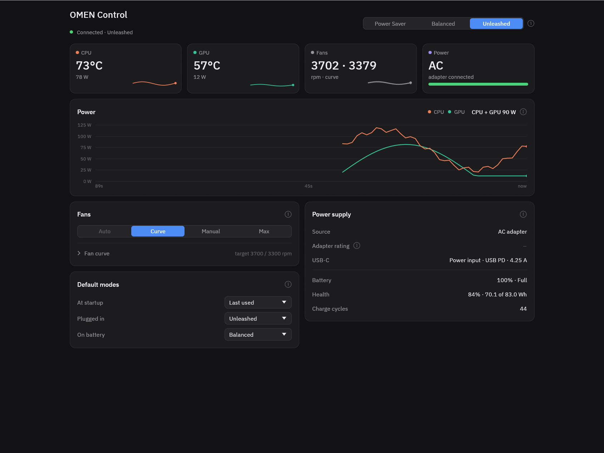

# omenctl

[English](README.md) | 简体中文

在 Linux 上控制 **HP OMEN 16-am0xxx（主板 8D3F）** 的性能模式和风扇。

在 Linux 下，这台笔记本的嵌入式控制器（EC，负责风扇和功率的单片机）把 CPU 限制在
PL1 45 W / PL2 56 W（平衡模式下是 35/45 W），把 RTX 5060 限制在约 80 W。原因是 Windows 上
OMEN Gaming Hub 会发送的那些固件命令，在 Linux 上没有程序去发。omenctl 通过内核的 `hp-wmi`
驱动发送这些命令，并补上固件在这种状态下要求软件承担的风扇控制。

**状态：测试版。** 作者每天在自己的电脑上使用：驱动、后台服务、命令行工具和图形界面都已在真机上
测试；真机测试清单（[docs/HARDWARE_TEST.md](docs/HARDWARE_TEST.md)，英文）还有部分项目没做完。
使用风险自负。



## 实测结果（Ubuntu 24.04，HWE 内核 7.0，BIOS F.14）

| | 原版 Linux | omenctl "Unleashed"（满血） |
|---|---|---|
| EC 的 CPU 功率上限 PL1 / PL2 / PL4 | 45 / 56 / 90 W | 90 / 130 / 200 W |
| CPU 单线程 | – | 4.94 GHz |
| CPU 8 线程（每个性能核一个） | – | 4.41 GHz @ 130 W |
| CPU 全部 24 线程持续负载 | 约 2.45 GHz @ 约 45–56 W | 性能核 3.78 / 能效核 3.03 GHz，90 W |
| 显卡功率上限 | 80–83 W | 115 W |

原始日志在 [`logs/`](logs/)。

## 功能

- 三种模式：**Power Saver**（省电）、**Balanced**（平衡）、**Unleashed**（满血：CPU 90/130 W，显卡 115 W）。
  满血模式下 CPU 能耗偏好保持 `balance_performance`，桌面空闲时约 25 W 而不是约 45 W，满载时功率上限不变。
- 默认模式：开机时、插上电源时、用电池时、电量低时各自切换到指定模式。
- 风扇：BIOS 自动、每个风扇一条曲线（默认用 BIOS 自带的风扇表）、手动固定转速、最高转速。
  曲线使用 5 秒平均温度，升速后保持 15 秒再慢慢降，短暂的负载尖峰不会让风扇忽快忽慢。
  手动转速低于曲线推荐值时允许设置，但会给出提示。
- 供电信息：CPU 和显卡功率及 90 秒曲线、适配器额定功率（读自 BIOS）、电池电量、耗电、剩余时间、
  健康度和循环次数、USB-C 供电。
- 图形界面（OMEN Control）支持 自动 / 浅色 / 深色；命令行工具
  `omenctl status | mode ... | fan ... | defaults ...`。
- 四层安全保护：任何故障都会朝"风扇更快、功率更低"的方向处理。
- 一个 `.deb` 安装包：DKMS 驱动（内核更新后自动重新编译并用 MOK 密钥签名）、后台服务、工具、
  `nvidia-powerd`。`apt remove` 可以完整恢复原来的系统。

（程序界面和 `docs/` 下的文档都是英文。）

## 安装

要求：HP OMEN 16-am0xxx（主板 `8D3F`，用 `cat /sys/class/dmi/id/board_name` 查看），
Ubuntu 24.04 + HWE 7.0 内核；安全启动（Secure Boot）要么关闭，要么已经注册了给 DKMS 用的 MOK 密钥
（安装第三方驱动时 Ubuntu 会引导你注册）。

从 [最新发布](https://github.com/ZerunW/omen-ctl/releases/latest) 下载 `omenctl_<版本>_amd64.deb`，然后：

```bash
sudo apt install ./omenctl_*_amd64.deb
sudo usermod -aG omenctl $USER               # 注销后重新登录生效
sudo reboot
omenctl status
omenctl mode unleashed
omenctl-gui                                  # 或者在应用菜单里打开 "OMEN Control"
```

完全卸载：`sudo apt remove omenctl`。完整说明、配置和排错见 [docs/USER_GUIDE.md](docs/USER_GUIDE.md)（英文），
每个版本的改动见 [CHANGELOG.md](CHANGELOG.md)。

蓝牙键盘没法把电脑从休眠中唤醒？那是 BlueZ 的问题，和 OMEN 无关，见配套项目
[bt-le-wake](https://github.com/ZerunW/bt-le-wake)。

## 工作原理（8D3F 专属细节）

以下来自反编译的 BIOS（`acpi/dsdt.dsl`、`acpi/ssdt17.dsl`）和 EC 读数：

- WMI 命令 `0x20008`/`0x1A` 把模式字节直接写进 EC 的 `0x95`（0x30 平衡，0x31 性能，0x04 也能被识别）。
  在 0x31 下，EC 把 PL1/PL2/PL4 提高到 90/130/200 W。
- `0x10` 会打开一个约 120 秒的窗口，窗口内 EC 按软件给定的转速（`0x2E`，EC `0x34/0x35`）
  运行风扇，而不用它自己的曲线。性能模式的功率上限只在这个窗口保持期间有效，所以风扇必须由软件
  驱动（OMEN Gaming Hub 就是这么做的）。上游驱动在手动风扇模式下每 90 秒续一次窗口。
- 在这台机器的 EC 上，`0x2E` 写 0 表示**停转**，而不是"自动"。
- `0x29` 的第 4 个字节设置 NVIDIA Dynamic Boost 使用的 CPU+显卡并发功率目标
  （`NPCF.OPAT = W * 8`）；写 75 W（OMEN Gaming Hub 用的值）后显卡上限变为 115 W。
  第 1、2 字节是 PL2/PL1（顺序和上游驱动的结构体相反）。
- BIOS 几乎不检查参数，所以程序只发送在 OMEN Gaming Hub 上观察到过的数值。

## 架构

```
omenctl-gui（普通用户）   omenctl（普通用户）
          \               /
     /run/omenctl.sock（omenctl 组可用，每行一条 JSON）
                 |
        omenctld（root，systemd Type=notify，带看门狗）
                 |   只读写标准 sysfs 文件
   platform_profile · hp-wmi hwmon pwm · omenctl_kick · omenctl_concurrent_tdp · omenctl_adapter_w
                 |
        hp-wmi（打过补丁，DKMS）  ->  BIOS WMI  ->  EC
```

## 仓库结构

| 路径 | 内容 |
|---|---|
| `app/omenctl-core` | 风扇曲线、配置、sysfs 读写、控制循环、通信协议 |
| `app/omenctld` | 后台服务 |
| `app/omenctl-cli` | 命令行工具 `omenctl` |
| `app/omenctl-gui` | 图形界面（egui） |
| `packaging/` | `.deb` 打包脚本、systemd 单元、DKMS 配置、安装/卸载脚本和安全脚本 |
| `docs/` | 使用说明和真机测试清单（英文） |
| `hpwmi-upstream/` | 上游 `hp-wmi.c`（提交 `e931e54edb0f`）和 `backport.patch` |
| `tools/` | 只读的 EC 快照脚本和真机测试脚本 |
| `logs/` | 测试日志 |
| `acpi/` | 主板 8D3F、BIOS F.14 的反编译 ACPI 表 |
| `PLAN.md` | 设计和实施计划（中文） |

### 驱动修改（`hpwmi-upstream/backport.patch`）

在上游 `hp-wmi`（从 v7.4-rc1 起已经支持 8D3F）的基础上：

1. 能在 Ubuntu 7.0 HWE 内核上编译（`ACPI_AC_CLASS`）；
2. `omenctl_concurrent_tdp`（只写，只接受 `75`，只对 8D3F 生效）；
3. 内核风扇看门狗 `omenctl_kick`：风扇处于手动模式时，如果用户程序 15 秒没有报到，
   驱动自己把两个风扇设到最高档；
4. 8D3F 上的平滑交接：把风扇交还 BIOS 时写入当前转速而不是 0；
5. `omenctl_adapter_w`（只读，只对 8D3F 生效）：通过只读的 BIOS 查询 0x0F 读取适配器额定功率，
   这个查询在 DSDT 里（`WMID.GSAS`）只读取 EC 字段。

## 安全设计

- 不直接写 EC；用户态程序只读写标准 sysfs 文件。
- 任何档位切换之前先把风扇切到手动；满血模式下拒绝 BIOS 自动风扇。
- 四层保护：内核看门狗、systemd 看门狗（异常退出后运行安全脚本）、风扇转速核对、
  降低功率的温度保护。

## 编译和测试

```bash
cd app && cargo test      # 单元测试，外加一个在模拟 sysfs 目录上运行后台服务的端到端测试
packaging/build-deb.sh    # 生成 packaging/out/omenctl_<版本>_amd64.deb（需要 Rust 和 dpkg-dev）
```

GitHub Actions 会在每次推送时运行测试并编译 `.deb`；推送 `v*` 标签时自动发布新版本并附上安装包。

## 许可证

GPL-2.0-or-later（驱动源自 Linux 内核的 `hp-wmi.c`）。见 `LICENSE`。
随附的 IBM Plex Sans 字体使用 SIL Open Font License 1.1
（`app/omenctl-gui/assets/IBMPlexSans-LICENSE.txt`）。

## 参考

- Linux `drivers/platform/x86/hp/hp-wmi.c`
- [ohman](https://github.com/P4R1H/ohman) 固件研究
- [OmenMon-Reborn](https://github.com/metamountain/OmenMon-Reborn-8BCA)（8D3F 风扇满速冻结的报告）
- [hp-omen-8603-linux](https://github.com/PickleHik3/hp-omen-8603-linux)
